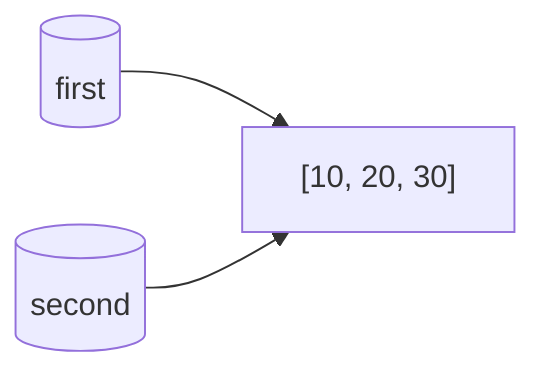
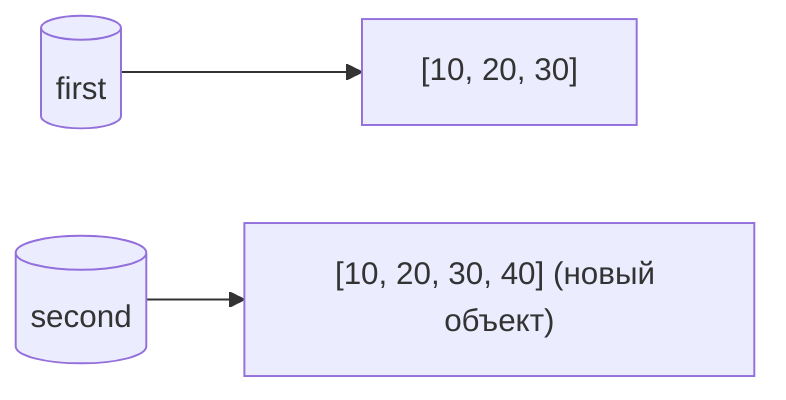
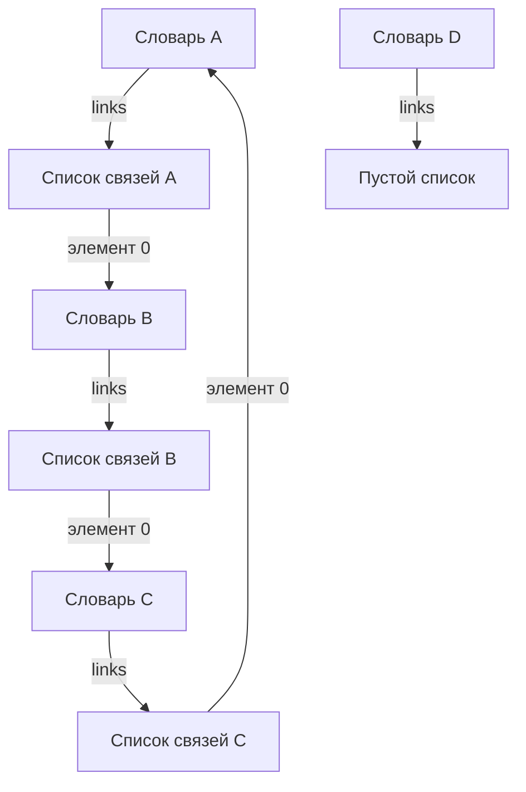

# Задание 1
## Эксперимент A. Неизменяемый объект
Ожидаемый результат:  
До изменения ```a``` и ```b``` равны ```10```, их ```id``` совпадают. После ```a += 1``` переменная ```a``` станет ```11```, а ```b``` не поменяется. ```id``` у ```a``` поменяется, а у ```b``` нет.  
Фактический результат:  
```text
До изменения: a = 10, b = 10
id(a) = 4372851984, id(b) = 4372851984
После a += 1: a = 11, b = 10
id(a) = 4372852016, id(b) = 4372851984
```
После операции сложения значение, связанное с именем ```b```, не поменялось, потому что ```int``` в Python является неизменяемыи типом данных. Оператор не меняет объект ```10```, а вычисляет новый результат ```11```, создает объект и перенаправляет имя на новый объект.
## Эксперимент B. Изменяемый объект
Ожидаемый результат:  
До изменения все так же как и в эксперементе А. После добавления ```30``` в ```second``` в ```first``` тоже добавиться ```30```. ```id``` не поменяется.  
Фактический результат:  
```text
До изменения: [10, 20] [10, 20]
4346108224 4346108224
После: [10, 20, 30] [10, 20, 30]
4346108224 4346108224
```
Пункт 4. Схема связей между именами и объектами:  

до переназначения:  

после переназначения:  


## Практическая задача:
Мы создали ```project1```, с некоторыми данными, сделали ```project2``` просто прировняв с ```project1``` и 
решили изменить там бюджет, но в итоге меняя ```project2``` вместе с ним меняетмся и ```project1```. В следующих строках мы пресоздали 
```project1``` и создали ```project2``` используя глубокое копирование и провели такую же операцию как и до этого, и ```project1``` не поменялся по того как мы поменяли ```project2```.

## Вопросы для анализа: 
1) Нет ```second = first``` не меняет ```first```, но если поменять ```second```, то ```first``` уже помняется.
2) Потому что такие объекты нельзя изменить, и мы не меняем сам объект, а просто присваиваем имени другой объект, который является результатом операции
3) Чтобы проверить, обозначают ли два имени один и тот же объект, нужно использовать  ```is```

# Задание 2
| Операция | Новый внешний объект | Новые вложенные объекты | Изменения независимы                              |
| --- |----------------------|-------------------------|---------------------------------------------------|
| Присваивание | тот же объект        | те же объекты           | изменения зависимы                                |
| Поверхностная копия | новый внешний объект | те же самые объекты     | зависимы только вложенные изменения               |
| Глубокая копия | новый внешний объект | новые вложенные объекты | изменения внешнего и вложенных списков независимы |


Создание матриц:  
В ```wrong_matrix``` мы берем список ```[0,0,0]``` и делаем матрицу из одного объекта, поэтому если мы изменим один список, изменится и другой. Это можно легко проверить операторм
```is```, ```print(wrong_matrix[0] is wrong_matrix[1])``` выдаст ```True```, значит это один и тот же объект в памяти.  
Во втором случае мы создаем 3 разных объекта благодаря циклу ```for```, поэтому меняя один список, остальные остаются неизменными. Так же можем проверить с помощью ```is```,
мы получим ```False``` 

## Вопросы для анализа: 
1. Поверхностное копирование, создает новый внешний объект, который содержит ссылки на прежние вложенные объекты, а
глубокое копирование создает новые внешние и вложенные объекты.
2. Потому что глубокое копирование не всегда необходим, часто хватает и поверхностного копирования, в таких случаях создание глубокой копии будет лишней тратой памяти
3. Когда нужно независимо добавлять и удалять элементы внешнего списка, а вложенные объекты менять не планируется.

# Задание 3
1) Когда я прередаю объект в функцию, появляетмя временная ссылка на время вызова функции, поэтому во время подсчета ссылок на одну временную ссылку больше. После выполнения функции временная ссылка удаляется.
2) Счетчик увеличивается, когда:
   1. Создается новая переменная с этим объектом
   2. Объект передается в функцию как аргумент
   3. Объект помещается внутрь контейнера
3) Счетчик уменьшается, когда:
   1. Переменная удалается через ```del```
   2. Переменная перезаписывается другим значением
   3. Объект выходит из функции
   4. Удаление ссылки из контейнера
4) ```del alias``` удаляет только имя и его ссылку на объект. Сам объект может использоваться через другие имена или контейнеры. В этом примере список остаётся в памяти, потому что на него ещё ссылается ```data```.

Слабая ссылка позволяет обратиться к объекту, но не удерживает его в памяти. Поэтому, когда на объект больше нет сильных ссылок, он может быть освобождён, а слабая ссылка после этого возвращает None.

Пример со слабой ссылкой:  
Еслу у нас есть двунаправленная структура данных(например, дерево где у Родителя есть ссылка на Детей, а у Детей ссылки на Родителей), тогда получается что счетчик ссылок никогда не будет равен 0. Поэтому можно сделать ссылку от Родителей к Детям сильной, а от Детей к Родилям слабой

## Вопросы для анализа: 
1) Объект удаляется из памяти если счетсчик ссылок становится равным 0
2) Нет, после освобождения объекта Python может оставить выделенную память внутри процесса и использовать для новых объектов.
3) Сильная сслыка может удерживать объект в памяти, а слабая - нет даже если на объект будет ссылаться 100 слабых ссылок

# Задание 4
1) Списки удерживают друг друга. После удаления имён first и second у каждого списка остаётся ссылка из другого списка, поэтому счётчики не становятся нулевыми. Хотя эти объекты уже недоступны программе,
один подсчёт ссылок не освобождает их. Циклический сборщик мусора обнаруживает такой недостижимый цикл и освобождает его.
2) Поколения позволяют проверять объекты с разной частотой. Новые объекты проверяются чаще, поскольку многие из них быстро становятся ненужными. Объекты, пережившие сборки, переходят в старшие поколения
и проверяются реже. Это уменьшает затраты на сборку мусора: не приходится каждый раз проверять все отслеживаемые объекты.

## Схема графа



## Вопросы для анализа: 
1) Циклическая ссылка возникает, когда объект ссылается на себя напрямую или через другие объекты.
2) Объект может удерживаться ссылками внутри цикла, хотя все внешние ссылки уже удалены. Его счётчик остаётся ненулевым, но из программы добраться до него уже нельзя.
3) Поколения позволяют проверять новые объекты чаще, а объекты, пережившие сборки, — реже. Многие новые объекты быстро становятся ненужными, поэтому такой подход уменьшает затраты на проверку всех отслеживаемых объектов.

# Задание 5
## Часть 1

Контейнер хранит ссылки на объекты, а не сами объекты внутри себя. Поэтому sys.getsizeof() учитывает память самого контейнера и место для ссылок, но не суммирует размеры объектов, на которые они указывают.
## Часть 2

1) Размер списка увеличивается не после каждого append(). Пока хватает зарезервированного места, добавление элемента не меняет размер внешнего списка. Когда место заканчивается, выделяется дополнительная память.
2) Запас нужен для ускорения добавлений. Он позволяет не выделять память заново при каждом append().
3) Длина списка — количество его элементов, которое возвращает len(). Объём выделенной памяти включает служебные данные списка и место для ссылок на элементы, в том числе ещё не занятые места. Поэтому длина может расти, а размер списка в байтах некоторое время оставаться прежним.
## Часть 3
Материализованная последовательность, например list(range(100_000)), хранит все элементы одновременно, поэтому занимает больше памяти. Объект range(100_000) хранит только начало, конец и шаг, а значения вычисляет по мере обращения к ним. Поэтому его размер почти не зависит от количества представляемых чисел.

## Итоговый анализ:

1) Не хранить все значения сразу, если их можно получать по мере необходимости. В задании 5 ```range(100_000)``` занимает значительно меньше памяти, чем ```list(range(100_000))```, поскольку хранит параметры диапазона, а не все числа.
2) Не использовать глубокое копирование без необходимости. В задании 2 поверхностная копия создаёт новый внешний список, сохраняя общие вложенные объекты. Если независимое изменение вложенных объектов не требуется, это позволяет избежать лишних копий.
3) Использовать слабые ссылки в реестрах, которые не должны удерживать объекты. В задании 3 записи в ```WeakValueDictionary``` автоматически исчезают после освобождения объектов. Такой реестр не сохраняет ненужные объекты только из-за их регистрации.
4) Удалять ненужные сильные ссылки, в том числе из контейнеров. В задании 3 ```del alias и container.clear()``` уменьшают число ссылок. Когда исчезает последняя сильная ссылка на объект без циклов, он может быть освобождён.

# Итоговый вывод

1) Самая опасная ошибка при работе с изменяемыми объектами — считать, что присваивание создаёт независимую копию. Несколько имён могут ссылаться на один список, поэтому изменение через одно имя будет видно через остальные.
2) Поверхностная копия создаёт новый внешний список, но вложенные списки остаются общими. Если их тоже нужно изменять независимо, нужна глубокая копия. Похожая ошибка возникает при создании матрицы через [[0] * n] * m: все строки ссылаются на один список. Для независимых строк нужно создавать каждую отдельно.
3) Удаление имени также не означает немедленное освобождение объекта: его могут удерживать другие ссылки. Для недостижимых циклов одного подсчёта ссылок недостаточно — требуется циклический сборщик мусора.
4) Чтобы избегать этих ошибок, нужно понимать, какие объекты остаются общими, выбирать подходящий способ копирования и проверять независимость через is и изменение данных.